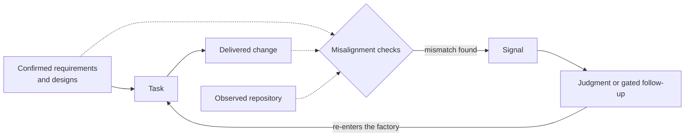
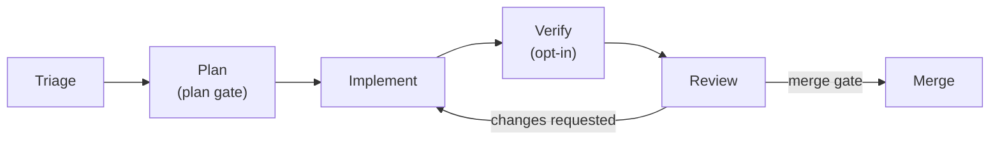

# Conveyor

Coding agents can produce changes faster than a team can review them. The
harder question is whether those changes match what the team intended to build.

Conveyor gives that work a defined process. Humans confirm requirements,
system designs, and decisions. Agents use those documents to plan, implement,
and review tasks on your machines, with human approval where required.

Requirements traceability gives reviewers a basis for checking the work and
identifying where it has drifted from the agreed intent.

Conveyor has used this process to build itself since July 2026.

https://github.com/user-attachments/assets/f50c12bc-81ed-429c-ba10-90dd3cdb8c34

## Get started

First, paste this instruction into your coding agent, such as Claude Code,
Codex, Cursor, or OpenCode:

```text
Set up Conveyor with me by following https://raw.githubusercontent.com/kidus-tiliksew/conveyor/main/docs/playbooks/conveyor-install.md
```

The agent asks about your setup, how your team works, and where you deploy,
and then sets Conveyor up with you.

## The knowledge graph

Conveyor links each change to the documents, task, review, and test evidence
behind it.



Conveyor checks each delivery against confirmed requirements and governing
designs. When a delivery and its confirmed intent disagree, Conveyor raises a
signal. Repository drift and post-merge failures raise signals too. Conveyor
never rewrites code or documents on its own. An operator can acknowledge the
signal or send follow-up work through the normal gates.

## The pipeline



Every task moves through explicit stages, and each stage has its own contract.
A task freezes its policy when it is created, and that policy can turn the
plan stage, the verify stage, and the merge gate off.

- **Triage** classifies the task and writes an advisory brief for the
  stages that follow.
- **Plan** runs when the plan gate is on. An agent writes the execution plan,
  and an operator approves it before implementation starts.
- **Implement** has an agent change the task branch in a dedicated worktree
  and submit it. Conveyor opens the pull request.
- **Verify** runs the repository's [verification kits](docs/playbooks/conveyor-kit.md)
  and ordinary checks against the submitted head and seals typed evidence. It
  runs only when the task's frozen `verify_stage` policy turns it on.
- **Review** sends the pull request to one or more independent reviewer
  seats. Each seat judges it against the pinned requirements, designs, and
  decisions. Self-review is refused. A `changes_requested` verdict sends the
  work back to a fresh implementation order.
- **Merge** happens after a readiness check. With the merge gate on, the
  operator performs the merge from the dashboard inbox, `conveyor run`, or
  `conveyor task merge`.

Each task's next action is computed on the server. The dashboard, CLI, and
MCP all show the same next action, so it is always clear whether the task is
waiting on an agent, a worker, or you.

## Documentation

Full docs live in [docs/](docs/README.md). There's no docs site yet.

**Getting started**

- [Setup playbook](docs/playbooks/conveyor-install.md): the procedure a coding agent follows to install and configure Conveyor with you

**Guides**

- [CLI reference](docs/cli.md): every `conveyor` and `conveyord` command
- [Authentication](docs/auth.md): sign-in, tokens, roles, GitHub identity
- [Configuration](docs/configuration.md): the three config surfaces and every environment variable
- [MCP reference](docs/mcp.md): the tools an agent uses to work a task

**The factory**

- [Concepts](docs/concepts.md): the software factory, the knowledge graph, light and dark factory patterns
- [The document corpus](docs/document-corpus.md): requirements, System Designs, decisions, and the propose-confirm cycle
- [Tasks](docs/tasks.md): how work is created, given context, executed, reviewed, and linked
- [Misalignment](docs/misalignment.md): drift, staleness, and pending proposals

**Operations**

- [Worker operations](docs/worker-operations.md): durable worker enrollment, service install, recovery
- [GitHub lifecycle](docs/github-lifecycle.md): how issues, PRs, and review statuses are projected onto GitHub
- [SingleStore operations](docs/singlestore.md): running the factory on SingleStore instead of PostgreSQL
- [The log core](docs/log-core.md): the event log and the durable queue that runs on it
- [Known limitations](docs/known-limitations.md): accepted boundaries of the current implementation

**Agent harnesses**

- [Cursor CLI](docs/cursor-build.md), [Grok Build](docs/grok-build.md), and [OpenCode](docs/opencode-build.md): worker setup for harnesses that receive MCP through the environment

**Playbooks** (installable as agent skills with `conveyor repo init` or `conveyor skills install`)

- [Setup](docs/playbooks/conveyor-install.md): install and configure Conveyor with a person, from one instruction
- [Planning](docs/playbooks/conveyor-planning.md): draft and push documents from a local agent session
- [Task filing](docs/playbooks/conveyor-task-filing.md): file well-formed tasks and dependency chains
- [Working a task](docs/playbooks/conveyor-work.md): the claim, checkout, submit, review lifecycle
- [Testing strategy](docs/playbooks/conveyor-testing-doc.md): write the testing-strategy System Design document that reviewers judge verification against
- [Authoring verification kits](docs/playbooks/conveyor-kit.md): declare repository kits in `.conveyor/kits/manifest.yaml`
- [Executing verification kits](docs/playbooks/conveyor-kit-verify.md): run kits and ordinary checks under a verify claim and submit typed evidence
- [Coordinating tasks](docs/playbooks/conveyor-coordinate.md): keep several tasks moving with one thread per stage order, routine decisions within delegated scope, and plain-language timeline text

[Checkpoint recovery](docs/playbooks/checkpoint-recovery.md) is an operator
procedure for recovering preserved implementation work. It is not installed
as a skill.

## Contributing

Contributions go through the factory too. To start contributing, request
access by opening an issue. You will get a workspace account to plan and
pick up work. Agents edit only under a live claim, in the task worktree that
`conveyor checkout <task-id>` resolves.

The backend is Go and the dashboard is React. `make build`, `make vet`,
`make fmt-check`, and `make test` are the local gate. `make test` covers Go
tests, the web typecheck, Biome, and Playwright. `make test-integration` runs
against PostgreSQL. Source development needs Go 1.24, Node 22 with npm,
and Docker with Compose. `make dev` starts a health-checked development
PostgreSQL on port 5432, builds both binaries, and runs `conveyord` on port
8080 with `conveyor.yaml` and `.env` from the checkout, which start as copies
of `conveyor.example.yaml` and `.env.example`.
[Local validation evidence](docs/validation-evidence.md) describes scratch
space and retained evidence for work on this repository.

## Acknowledgements

Supported by the awesome [FunnelFlux](https://funnelflux.com) team ❤️

## License

Conveyor is available under the [MIT License](LICENSE).
