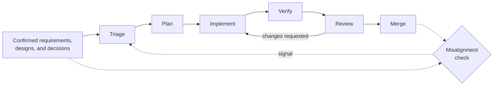

<p align="center">
  <picture>
    <source media="(prefers-color-scheme: dark)" srcset="docs/assets/conveyor-mark-white-on-black.png">
    
  </picture>
</p>

<h1 align="center">Conveyor</h1>

<p align="center">
  A software factory where coding agents build what your team agreed to build.
</p>

<p align="center">
  <a href="https://github.com/kidus-tiliksew/conveyor/actions/workflows/ci.yml"></a>
  <a href="https://github.com/kidus-tiliksew/conveyor/releases/latest"></a>
  <a href="LICENSE"></a>
</p>

<p align="center">
  <a href="#get-started">Get started</a> ·
  <a href="#how-it-works">How it works</a> ·
  <a href="docs/README.md">Documentation</a> ·
  <a href="CONTRIBUTING.md">Contributing</a>
</p>

---

Coding agents write changes faster than a team can review them. The harder
question is whether those changes match what the team meant to build.

Conveyor answers it with a process. People confirm the requirements, system
designs, and decisions. Agents plan, implement, and review against them on
your own machines, and every change traces back to the documents behind it.
Conveyor is built this way too.

https://github.com/user-attachments/assets/f50c12bc-81ed-429c-ba10-90dd3cdb8c34

## Get started

Paste this into your coding agent:

```text
Set up Conveyor with me by following https://raw.githubusercontent.com/kidus-tiliksew/conveyor/main/docs/playbooks/conveyor-install.md
```

The agent asks about your setup, how your team works, and where you deploy,
then sets Conveyor up with you.

## How it works



Every task moves through explicit stages, each with its own contract:

- **Triage** classifies the task and briefs the stages that follow.
- **Plan** has an agent write the execution plan for an operator to approve.
- **Implement** has an agent change the task branch in its own worktree.
  Conveyor opens the pull request.
- **Verify** runs the repository's
  [verification kits](docs/playbooks/conveyor-kit.md) and records the evidence.
- **Review** sends the pull request to independent reviewers, who judge it
  against the confirmed documents. Agents never review their own work.
- **Merge** follows a readiness check, performed by an operator when the
  merge gate is on.

Plan, verify, and the merge gate are per-task policy. The server computes each
task's next action, so the dashboard, CLI, and MCP always agree on whether a
task is waiting on an agent, a worker, or you.

### Staying aligned

Conveyor checks each delivery against the requirements and designs that
govern it. When they disagree, or when the repository drifts or a merge
breaks something, Conveyor raises a signal. It never rewrites code or
documents on its own: an operator acknowledges the signal or sends follow-up
work back through the same gates.

## Tips

Workflows that have worked well so far:

- **Run your agents from [T3 Code](https://github.com/pingdotgg/t3code).**
  Conveyor gives each stage its own agent, and T3 Code lets one session start
  and follow agents from different providers side by side. You can see every
  stage's thread in one place and step into any of them.
- **Use a different model to review than to implement.** Conveyor already
  keeps agents from reviewing their own work. A reviewer from another model
  family also catches mistakes the implementer's model tends to miss.
- **Coordinate from one session.** Ask a single agent to move a set of tasks
  through the queue with the `conveyor-coordinate` skill. It starts a fresh
  agent for each stage order and brings you only the decisions that need you.
- **Plan in conversation, then file.** Talk a feature through with an agent
  using `conveyor-plan`, confirm the requirements and decisions, and only then
  file tasks with `conveyor-file-tasks`. Small, dependency-ordered tasks review
  faster than large ones.
- **Let CI be the evidence.** Agents run quick, focused tests while they work
  and leave full suites to CI. Reviewers check a green run on the exact commit
  under review.
- **Put the evidence in the pull request.** When the pull request lists what
  was tested and links the results, reviews take minutes. When it doesn't,
  tasks bounce back.
- **Get gates on your phone with [AgentDesk](https://github.com/kidus-tiliksew/AgentDesk).**
  Plan approvals, merges, and document confirmations wait on you. AgentDesk
  sends each one to you as a question you can answer from anywhere, so the
  queue doesn't stall while you're away.
- **Ask for plain-language decisions.** Have agents explain each option in
  plain words before citing requirement and decision IDs.

## Documentation

Concepts, guides, references, and the agent playbooks live in
[docs/](docs/README.md).

## Contributing

Contributions go through the factory too. Open an issue to request a
workspace account, then pick up work like any other agent or operator.
[CONTRIBUTING.md](CONTRIBUTING.md) covers the development setup.

## Acknowledgements

Conveyor's development is supported by [FunnelFlux](https://funnelflux.com) ❤️

## License

[MIT](LICENSE)
