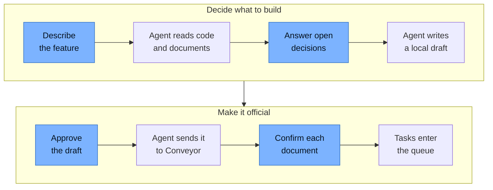
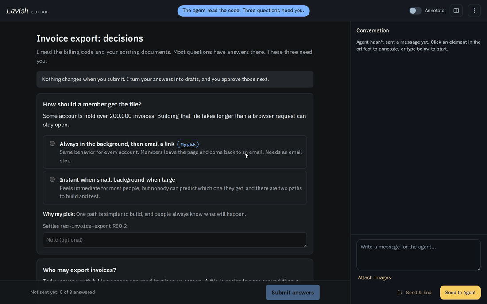
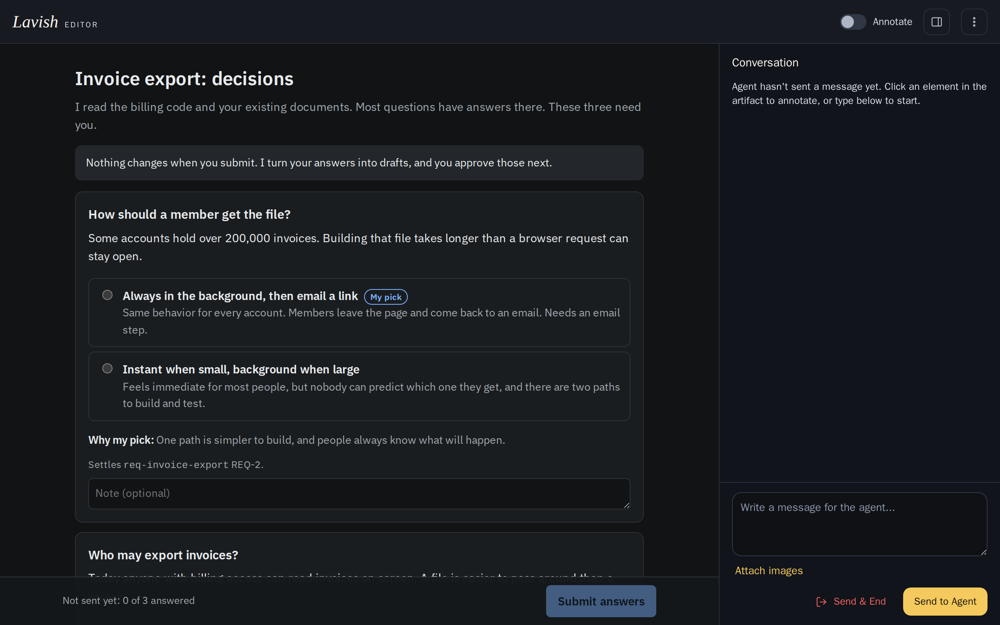
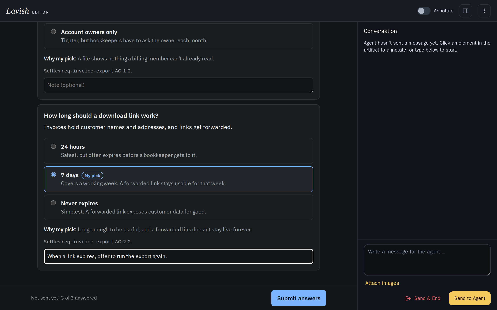
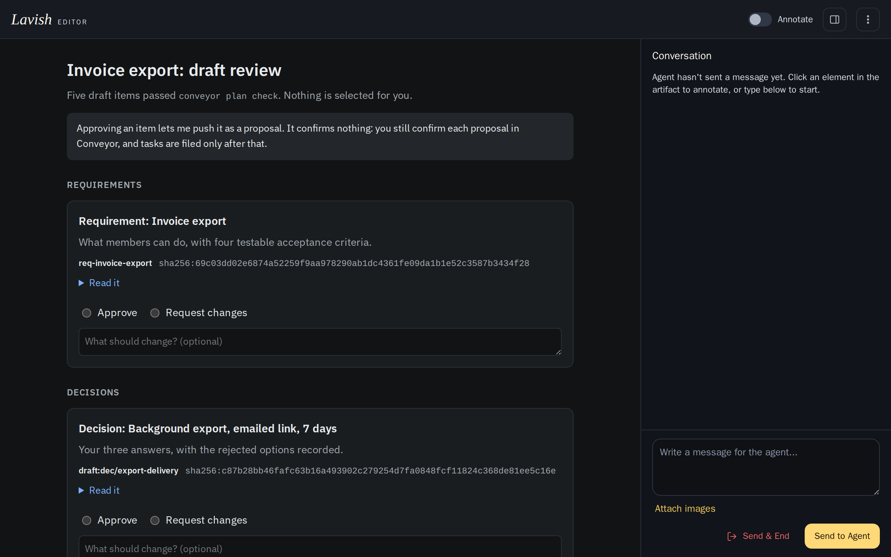
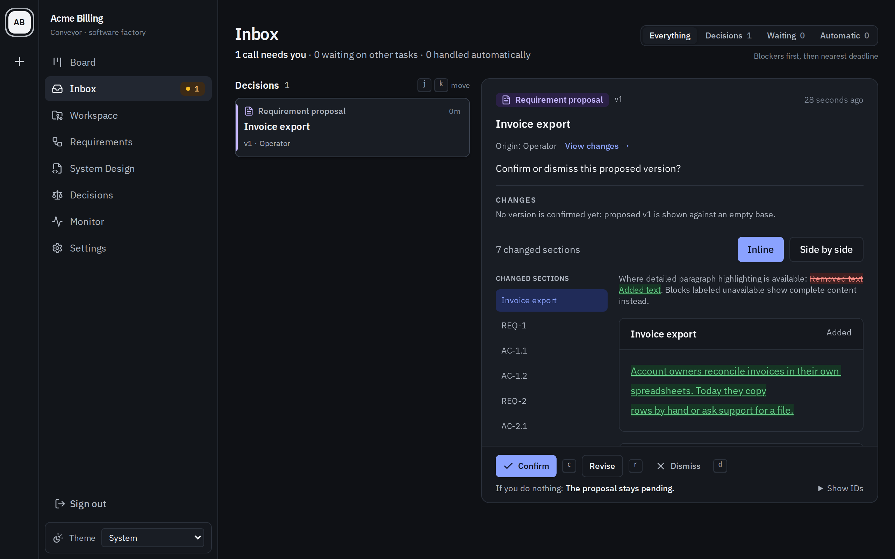

# Planning guide

With coding agents, what you get out depends on what you put in. Give a colleague a
vague request and they'll question it, and you may realize you hadn't thought it
through. An agent usually won't. It guesses at whatever you left out and returns
something that looks complete, and the gaps in your thinking stay hidden. Those gaps
are yours to close, because nobody else knows what you meant.

So your attention moves to the two ends of the work: saying clearly what you want at
the start, and checking what comes back at the end. Planning is the first of those.
It turns what's in your head into written requirements and decisions, which agents
build from and reviewers check the work against.

That doesn't mean writing those documents yourself. In this workflow, which has
worked well for us, the agent does the reading, drafting, and commands. You make the
decisions, shown in blue.



<a href="assets/planning/lavish-planning-demo.gif">
  
</a>
<sub>A planning round in <a href="https://github.com/kunchenguid/lavish-axi">Lavish</a>, using a made-up invoice export feature. The agent's messages are scripted. The answers and approvals went through a real Lavish session and <code>conveyor plan approve</code>.</sub>

## Set up

We use Lavish, which opens a page your agent wrote, lets you answer or comment on
it, and sends your feedback back to the agent.

```sh
npx skills add kunchenguid/lavish-axi --skill lavish
```

Lavish is optional. Without it, the agent asks you in the conversation. If you
like it, tell your agent to save that as your preference, in its memory or in
your `CLAUDE.md` or `AGENTS.md`, so future planning sessions use it without being
asked.

## Step by step

### 1. Describe the feature

Start an agent session in your project checkout:

```text
Use conveyor-plan to plan invoice export. Bring me the decisions you can't
settle yourself on a Lavish page, in plain words.
```

### 2. Answer the decisions that need you

The agent settles what the code and documents already answer, and brings you the
rest. It can suggest an option, but nothing is selected for you.

<a href="assets/planning/decisions-open.png">
  
</a>

Pick an answer, and add a note where the options don't quite fit.

<a href="assets/planning/decisions-answered.png">
  
</a>
<sub>Submitting queues your answers, and <b>Send to Agent</b> delivers them. Neither changes a document.</sub>

### 3. Let the agent write the draft

You don't need to do anything here. The agent turns your answers into documents
and tasks, checks them with Conveyor's validators, and fixes what they report.

### 4. Review what the agent wrote

The agent brings you a second page, with one card for each document and task it
wrote. Read any of them, then choose **Approve** or **Request changes**. If you
request changes, the agent revises that item and asks you again.

<a href="assets/planning/draft-open.png">
  
</a>
<sub>The long code on each card identifies that exact version. If the agent edits an item later, your approval no longer counts.</sub>

Approving only lets the agent send the item to Conveyor as a proposal. Nothing is
official yet.

### 5. Confirm the documents

The agent sends the documents to Conveyor one group at a time: requirements, then
decisions, then System Designs. Each one waits in your Inbox, where you can read it
and confirm or dismiss it. You can also give the agent your answer in the
conversation. Agents are held only to what you confirm.

<a href="assets/planning/inbox-confirm.png">
  
</a>

### 6. Tasks enter the queue

Once the documents are confirmed, the agent files the tasks. For work that changes
no document, skip all of this and ask the agent to file tasks with
`conveyor-file-tasks`.

## Further reading

See [The document corpus](document-corpus.md) for what each document is, and
[Concepts](concepts.md#the-knowledge-graph) for the knowledge graph.
