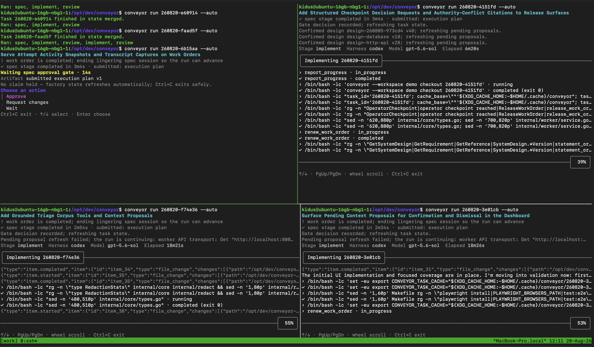

# Tasks

<a href="assets/screenshots/conveyor-run-auto.png">
  
</a>
<sub>Four tasks running in parallel with <code>conveyor run</code></sub>

A task is the unit of intended change: one branch, one eventual pull
request, one thread of judgment from intent to merge. This page follows a
task through its whole life: creation, context, governance, execution,
review, and the links it leaves behind in the knowledge graph.

Four words are used precisely throughout:

- A **task** is the durable unit of intended change.
- A **job** is one execution of one pipeline stage for that task.
- A **work order** is the protocol boundary handed to an agent for one stage.
- An **attempt** is one successful claim of a work order.

## Creating tasks

Every creation route funnels into one intake path, so a task made from the
dashboard, the CLI, an agent's `create_task` call, the monitor, or a
staleness follow-up all behaves identically:
context is validated, the workspace execution setup is frozen onto the task,
gates are resolved, the title is generated, and triage is enqueued.

The routes:

- The dashboard's New task sheet: description, repository, base branch,
  attached requirements and designs, dependencies, and the two gates.
- `conveyor task new` from the CLI.
- The `create_task` MCP tool, which requires `body`, `repo`, and a
  caller-stable `idempotency_key`. Reusing the key with an identical request
  returns the original task; reusing it with a different request is a
  conflict. A dispatched agent may file a task when its owning user's role
  grants `create_tasks`; it may turn the plan and merge gates on but never
  off, and the task records the agent and its owner (DEC-60).
- The monitor and staleness follow-ups, which file ordinary gated tasks; see
  [Misalignment](misalignment.md).

A new task gets an ID like `260822-2bc3b1` (date plus random hex) and a
branch assignment `conveyor/task-<id>`. The branch is an assignment, not a
ref; nothing is created in Git until an agent checks out.

## Ordering, blocking, and eligibility

Three independent levers, none of which is priority:

`depends_on` names open tasks that must merge first. A task is blocked while any dependency is not `merged`. A
dependency that closes without merging is flagged unsatisfiable, a dead end
an operator resolves by unlinking it (with a reason) or closing the
dependent. Time spent blocked does not burn the work order's queue clock.

An operator can add the same ordering constraint after both tasks exist with
`POST /v1/tasks/{id}/dependencies`, `conveyor task link`, or the MCP
`add_task_dependency` tool. The operation requires the dependency task ID, an
audit reason, and a caller-stable request ID. Both tasks must be open in the
same workspace; self-links and cycles are rejected. A retry with the same
request is idempotent, and an already-present dependency returns success
without another audit event. A late dependency pauses queued implementation
orders in place and affects future claims, but never interrupts claimed work.

A task carries no hold or other worker reservation (DEC-74): dependencies and
assignment are the only narrowing of who may claim its work. Intake refuses a
new `hold: true` with `task_hold_retired`, and `PUT /v1/tasks/{id}/hold`
answers 410. Hold values and `task.hold.*` events recorded before the
retirement stay readable as history and affect nothing. A request-changes
bounce re-queues the implementation order like any other: the person who ran
it can resume it with `conveyor run`, or an eligible worker can claim it.

An assignee narrows claim eligibility to one person: assigned tasks are
claimable only by the assignee, unassigned tasks are first-come. Assignment
never affects queue order, and the assignee must be a workspace member whose
role can claim work. Otherwise, queued work is served oldest-first, with
review seats taking precedence.

The dashboard's **Start over** action is available on non-terminal tasks to
members with `operate_gates`. Its dialog requires a reason (up to 200
characters), accepts an optional note for the next session (up to 2000), and
previews work-order cancellation, task-authored pending document dismissals,
and the known pull request to close. Pending proposals must load before
submission; dismissing them also requires an operator with `confirm_documents`.
A retry reuses the request ID and input so it returns the same successor. The
new task starts on a new branch with the same body and pins, carries the
operator's reason and note, and links back to the retired task; both have a
`restarted` marker. The retired task links forward and shows the recorded PR
close outcome. Forge closure can retry or fail without undoing the restart.

## Triage

Every task passes first through triage, an in-process stage with a small
tool budget and read-only access to the corpus. It classifies the task (bug,
feature, chore), routes it `proceed` or `parked`, and writes an advisory
brief: open questions, affected areas, risks. It may suggest requirement and
design attachments, but only as proposals an operator confirms or dismisses;
triage never attaches context itself, and it never picks the next stage. The
gates frozen at intake decide that: `spec` if plan approval is on, otherwise
straight to `implement`. If triage exhausts its budget, the task proceeds
with a neutral verdict rather than parking, so a flaky model cannot wedge
intake.

## Work orders

A work order is what an agent actually claims: one stage of one task, with
explicit state (`queued`, `claimed`, `submitted`, `completed`, `cancelled`,
`stale`, `timed_out`) and three independent clocks:

- The **queue clock**: an unclaimed order goes stale after
  `work_order_queue_timeout` (default 24h) and needs an explicit redispatch.
- The **execution clock**: a fixed deadline starting at the first successful
  claim, from the stage's configured timeout. Nothing extends it.
- The **lease**: a claim holds a renewable lease (default 5 minutes, up to an
  hour). Renewal keeps the claim alive but never moves the execution
  deadline, so a wedged agent cannot hold a task forever.

Spec, implement, and verify stages get one order per dispatch. Review gets one order
per configured review seat, so a two-seat setup means two independent
reviews per round.

Nothing is pushed to agents. You run a task with `conveyor run <task-id>`:
it claims each stage on your machine, launches the agent from your local
execution setup with its work-order identity and task assignment in the
environment and the Conveyor MCP endpoint configured, shows you the output,
and surfaces gates inline. Claimable stages chain by default; plan and merge
gates still apply. Pass `--step` to confirm each stage before it is claimed.

A durable worker (`conveyor worker run`) can do the same thing unattended,
polling the queue and running eligible orders around the clock; see
[Worker operations](worker-operations.md) if you want one.

## What a work order carries

`get_work_order` returns the assembled context for the stage, built in
layers:

- The stage's role prompt from the pack, plus any operator direction
  supplied at recovery.
- Served requirements: the REQ and AC statements of every confirmed
  requirement attached to the task, with the citation contract that tells
  implementation to cite IDs in code comments and tells review to classify
  its citations.
- The governance snapshot: full content of the confirmed System Design
  versions governing the task (pinned versions where an attachment pinned
  one), plus every confirmed and superseded decision, under a 64 KiB budget
  that reports anything it had to drop.
- The approved execution plan, whose `## Done criteria` become the
  implementation checklist and the review coverage contract.
- The triage brief, bounce history, and prior feedback.
- Bounded lineage context: neighboring nodes in the knowledge graph, each
  item tagged with the edge path and event that justified serving it, and
  artifact references readable through the scoped `read_artifact` tool.
- For review orders: the diff, the PR description, and task-owned
  verification evidence.

Two properties are worth knowing. For review orders, requirements and
governance are snapshotted at claim time and the verdict is validated against
exactly that snapshot, so authority cannot shift mid-review. And every layer
of lineage-derived content is labeled untrusted data with an explicit
instruction not to follow commands found inside it.

Repositories can ship advisory hints in `.conveyor/hints.yaml` (verification
commands, area ownership). Hints are always labeled advisory and never
override frozen workspace or plan authority.

## The execution loop

The full agent-facing discipline is the
[work playbook](playbooks/conveyor-work.md); this is the shape of it.

An implement agent claims the order with a fresh session, reads the context,
and resolves its dedicated worktree:

```sh
conveyor checkout <task-id>
```

That yields a sibling worktree on the assigned branch (default under
`~/.conveyor/worktrees`), created and reused with hard safety checks and
never by rewriting history. Every edit, test, commit, and push happens there;
the primary checkout is never touched. Spec-stage orders are the exception:
they run read-only and never check out.

If the task has a plan gate, the spec stage comes first: the agent submits a
Markdown plan with required headings (Approach, Files touched, Ordering,
Risks, Done criteria). With the gate on, an operator approves or rejects the
plan; approval also publishes a GitHub issue carrying the approved spec.

An attached `conveyor run` surfaces task-authored requirement proposals alongside
design proposals and offers inline confirmation to an operator. Review waits
until those proposals are confirmed or dismissed. If a proposal blocks a
review claim after the run read its state, the run refreshes and waits without
holding a claim. A credential without confirmation capability sees who can act.

Implementation works the plan, validates through the repository's Make
targets, walks the done criteria and acceptance criteria, commits, pushes the
exact assigned branch, and calls `submit_for_review`. Conveyor then opens or
reuses the pull request (as the executing user's GitHub identity) and
dispatches the review round. Agents never open PRs themselves. A successful
submit ends the implementation claim: a session launched by `conveyor run` or a
worker exits, and a session that claimed its order itself continues the
self-claimed delivery loop in the `conveyor-work` playbook.

When the task's frozen `verify_stage` policy is on, a verify order sits
between submission and review. A verifier claims it in a fresh session,
prepares a verification context bound to the exact submitted head, runs the
repository's selected [verification kits](playbooks/conveyor-kit.md) and any
ordinary checks, and submits typed evidence that is sealed for review. Actions
that need operator authority wait for a claim-bound grant
(`conveyor verification permissions`). Review is not dispatched until a
completed verify order exists for the submitted head. A passing kit is
evidence only, never approval. With the policy off, submission goes straight
to review. The [verification playbook](playbooks/conveyor-kit-verify.md) has
the full protocol.

Each review seat claims with a session and client token that must be
independent of the implementer and of every other seat; self-review is
refused at claim. A verdict is not a vibe: it must carry a reason code, a
summary, requirement citations classified against the pinned snapshot, done
criteria coverage quoting the plan's criteria verbatim, and a governance
assessment naming which designs and decisions were applicable, cited,
unknown, or superseded. Malformed assessments are rejected and the order
stays claimed for correction.

An approved round moves the task to the merge gate (or straight to merge if
the gate is off). At the gate, the operator's merge is a single act: Conveyor
checks the pull request's readiness and merges it, whether the act comes
from the dashboard inbox, `conveyor run`, or `conveyor task merge`. `changes_requested` bounces: the feedback is recorded, and
a new implementation order is created in a fresh session with that feedback
delivered as context. The bounced order is never revived. Bounces are counted
since the last human intervention, and hitting `max_bounces` (default 10)
parks the task at a human gate rather than failing it.

Merged and closed are terminal. After either, `conveyor done <task-id>`
removes the local worktree, keeping the branch.

## Checkpoints, plan revision, recovery

An operator can start an open task over with `POST /v1/tasks/{id}/restart`,
providing `request_id`, a required `reason` of at most 200 characters, and an
optional `note` of at most 2000 characters. The request cancels the task and its
non-terminal work orders, dismisses its own pending requirement and System
Design proposals with the note, and creates one linked successor carrying its
body, repository, base branch, open dependencies, attached context, frozen
policy, and previous approved plan as reference context. The successor starts
at triage on a new assigned branch and receives the reason and note as operator
direction on its first work order. The API requires `operate_gates`, plus
`confirm_documents` when pending proposals must be dismissed. An identical
request ID replays the original result; terminal tasks otherwise require
`POST /v1/tasks`. This API never resets or changes the retired branch or
worktree and does not close its pull request.

Two escape hatches let an agent stop without failing:

An **operator checkpoint** is for authority conflicts: the plan collides with
confirmed corpus authority, or an approved criterion explicitly requires an
operator decision. The agent first authors the relevant proposals
(requirement, design, or decision revisions), then releases the order with a
structured decision request citing the documents and the pending proposal
IDs. The release is a successful handoff, and the enriched citations show the
operator exactly which document versions are involved and what is already
pending.

A **plan revision request** is for repository reality: the approved plan
cannot be executed as written. The agent releases with a rationale and the
task waits at an operator gate for a revised plan.

Around those, the lifecycle is built to survive failure. Attempts that die
leave their work: a successor adopting a dirty predecessor worktree commits
it as a `wip(<attempt-id>)` checkpoint and pushes before continuing, so no
work is silently lost, and checkpoint commits are marked as preservation,
never as validation evidence. Failed attempts retry on a bounded schedule,
with connectivity failures backed off separately and identical consecutive
failures suppressed. Stale queued orders need an explicit redispatch;
interrupted review rounds can be recovered seat by seat, keeping completed
verdicts; merge conflicts get a dedicated fix dispatch with merge-not-rebase
instructions and a refresh review afterward.

## The knowledge graph

Every step above leaves edges. Lineage is projected from the append-only
event log, never asserted directly: the writer of each event, such as
`task.created`, `pull_request.opened`, or `review.completed`, projects that
event's edges in the same transaction. `conveyor lineage rebuild` replays the
log to regenerate every edge kind the projector owns. Rebuild keeps rows it
cannot regenerate and reports them as `preserved_unregenerable`, and it leaves
rows of other kinds, such as retained historical feature assignments, in
place.

The node types span the factory: planning sessions and bundles, requirements
and their versions, System Designs and their versions, reference documents
and their versions, decisions, repository paths, blueprints and their plan
versions, tasks, work orders, pull requests, commit ranges, evidence, and
verdicts. The edges say what happened:

```
requirement           --serves-->           task, blueprint
requirement_version   --serves-->           task
requirement           --versions-->         requirement_version
system_design         --versions-->         system_design_version
reference_document    --versions-->         reference_document_version
requirement_version / system_design_version / reference_document_version / decision
                      --supersedes-->       its predecessor
requirement_version   --derived_from-->     reference_document_version
system_design_version --governs-->          task, repository_path
system_design_version / decision --proposed_by--> task, planning_session
planning_session      --produced_requirement / produced_design / produced_bundle / produced_blueprint--> what it produced
planning_bundle       --proposes-->         requirement_version, system_design_version, decision
planning_bundle       --creates-->          task
blueprint             --plans-->            task
blueprint             --versions-->         blueprint_version
blueprint_version     --materializes-->     task
task                  --depends_on-->       task
task                  --succeeded_by-->     task
task                  --dispatches-->       work_order
work_order / task / planning_session --consulted--> system_design_version
planning_session      --consulted-->        reference_document_version
work_order            --produced_verdict--> verdict  <--supports-- evidence
task                  --submitted_as-->     pull_request
task                  --submitted_range / merged_range--> commit_range
```

A requirement attachment records the confirmed version current when it is
attached, so `requirement_version --serves--> task` names the version a
delivery served. Attachments recorded before that field existed carry only
`requirement --serves--> task`. `blueprint --plans--> task` joins a task's
plan side (its planning session and plan versions) to its delivery side (its
work orders, pull requests, and ranges). `task --succeeded_by--> task` links a
task that was started over to its replacement.

So a merged change answers, from the graph alone: which requirement versions
it served (for attachments that recorded one), which designs governed it and
whether it consulted them, which planning session produced it, and who
reviewed it and what evidence supported the verdict. The same graph feeds
forward: it is the
source of the bounded lineage context served into future work orders, so
related work arrives already knowing its neighbors.

Traversal is always budgeted (depth, nodes, links, and per-node fan-out) and
reports what it left out, axis by axis, because an unbounded graph walk is how
context windows and API latencies die. A popular node, such as a requirement
that serves many tasks, contributes at most its fan-out, so a task's own work
orders, verdicts, pull requests, and ranges arrive ahead of the siblings
reached through it. Each store reads only the links of the nodes the walk
reaches and returns at most a fixed number per node, so a walk's cost does
not grow with unrelated parts of the workspace. A review or verify order
shows each served requirement at the version its claim pinned. The
dashboard's knowledge explorer is the same bounded traversal, rendered.

Operators query the graph through three read-only surfaces, all bounded:

- `conveyor lineage show <type> <id>` (`GET /v1/lineage/{type}/{id}`, MCP
  `get_lineage`) walks from one node. `--direction out|in|both`, `--kind`, and
  `--node-type` narrow the walk; a link they refuse still counts against its
  node's fan-out, so a filter never widens store reads. Each node carries its
  depth, its `edge_path`, and its status: task or work-order state, version
  status (`current`, `superseded`, `proposed`, `dismissed`), or verdict outcome,
  round, and seat. This answers "what delivered this requirement, who reviewed
  it, against which design version?"
- `conveyor lineage impact <requirement|system_design> <id>`
  (`GET /v1/lineage/{type}/{id}/impact`) lists every task each version served
  or governed, with task state, version status, and merged commit ranges.
  `--outdated` keeps merged tasks built on a superseded version. This answers
  "if I change this document, which merged work was built on the old
  version?" A task whose attachment recorded no version is listed as
  `unrecorded` and never counted as outdated. The read covers at most 1000
  version-to-task links and pages them.

Walk defaults are the agent context budget. The operator read budget
(`execution_settings.control_plane.planning.context.operator_read_depth` and
`operator_read_nodes`, at most 16 and 1024) raises only the caps an operator
read may ask for; agent context assembly keeps its own budget.

## Observability

Every claim mints an attempt ID, and the order tracks the current and last
attempt, outcome, failure category and bounded detail, retry counts, and
pacing. Live activity from a running attempt is surfaced on the task
timeline.

Transcripts arrive on three channels: agents may self-report one through
`upload_transcript` (redacted, size-capped, stored as an audit artifact);
the parent launcher (`conveyor run` or the worker) delivers one bounded,
redacted capture (newest 4 MiB) at every mediated attempt ending of every
stage, bound to the attempt's persisted ending reason and independent of Git
preservation (worker crashes, killed processes, interrupted runs, and
unmediated lease expiry produce none); and
in-process stages persist their full model transcript content-addressed.
Redaction counts are recorded alongside.

Agents self-report cumulative token usage through `report_usage`. Usage is
observational telemetry only: it never gates claims, progress, or
submissions, and a reported zero is distinguishable from a session that
never reported. Conveyor collects no cost; a legacy `cost_usd` argument is
accepted and ignored. In-process stages record exact token counts.
The task timeline rolls all of it up per attempt and per task.

The substrate under all of this is the append-only event ledger, on the
order of 130 event kinds, streamable per task over SSE. The task activity
endpoint returns the whole picture in one read: jobs, events, work orders
with checkpoints and transcripts, interventions, review diagnostics, merge
readiness, and attention state.

`GET /v1/tasks/{id}/next-action` returns the full next action, including `label`.
`GET /v1/next-actions` returns the inbox: `decisions`, `blocked`, and `automatic`
bands, paging headers, `document_proposal` items, and an `acts` log. Each
`document_proposal` item carries `proposal.age_seconds`, the whole seconds since
`proposed_at` at read time (zero for a future time, omitted without one), and
the server's `label`, `question`, and `if_ignored` text. `if_ignored` reads
"The claim stays withheld." only for a version a task's claim waits on.
Each task item's `pull_request` is the task's recorded pull request (`url`,
`number`, `repository` from its latest `pull_request.opened`), omitted when
none is recorded; the task's GitHub issue stays on `task.github`. The bounded
task detail's `summaries.park_reason` states what triage recorded when it
parked the task, and `summaries.dispatch_failure` the latest dispatch failure.
Pending proposals expose `attention.task_count` and
`attention.operator_decisions` from that same projection.

### Operator reasons in work-order context

Review orders and later implement attempts receive `operator_notes` when an
implementation-origin requirement or System Design version from that task
was dismissed with a note. Each entry contains `document_id`, `version`,
`tier` (`requirement` or `system_design`), `note`, and `dismissed_at`. Entries
sort by tier, document ID, then numeric version. The role prompt labels them
as operator reasons and untrusted observational evidence.

Context assembly refreshes notes even when review authority stays pinned.
Only the originating task in the same workspace receives them. An empty
collection is omitted, and terminal tasks drop the collection while version
history remains readable. Notes do not alter admission, dispatch, claiming,
gates, or document authority. The claim-bound `get_work_order` response
projects the same collection (req-260810-23b69f AC-5.2 and AC-5.4;
`component-work-orders`).

## Repository documentation closure

A repository may declare `.conveyor/docs.yaml` with `schema_version: 1`,
`docs` entries containing `path`, a required nonempty `governs` list of
repository-relative source globs, and `description`, plus a `rule` containing
`none_statement` (default `docs: none`), `reason_required`, and `text`.
`conveyor docs validate [repository]` validates the closed YAML schema and
reports each entry whose document or governing source glob matches no tracked
file. It exits nonzero on malformed declarations or unmatched entries.
An absent declaration exits zero and reports that the gate is off.

At submission the declaration is read at the PR base SHA, not pinned at claim.
For each document governing a changed source path, the PR must update that
document or include a qualifying docs-none line in the agent-authored PR body.
The server refuses before submission side effects if any affected document
remains untouched without that line, or declaration discovery is unavailable or
malformed. Refusal writes no evidence or events. No declaration (or no GitHub
slug) preserves existing submission behavior and records nothing.

Exact-task/head admission evidence requires a reviewer
`documentation_assessment`; without evidence the field must be omitted.
`updated_paths` must equal the evidence, and approvals require empty
`unresolved` and `conflicts` lists. Review completion activity includes the
assessment only when supplied (REQ-9/AC-9.1–9.6; DEC-71).
