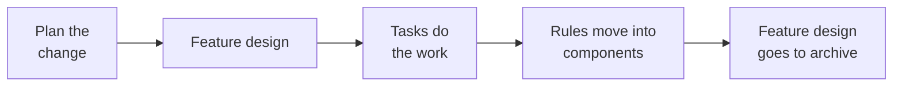

# Writing requirements and designs

The [planning guide](planning-guide.md) shows how you and an agent write
documents together. This guide shows what a good document looks like.

In Conveyor, an agent builds only from your documents. It did not see your
conversation, and it cannot speak to you. A second agent then examines the
work against the same documents. If a sentence is not clear, the first agent
makes a guess, and the reviewer cannot find the error.

## Four kinds of document

Each kind of document has one job. Do not put one job in a different kind of
document.

| Document | It tells the reader | It changes when |
| --- | --- | --- |
| Requirement | What users get | You change what you promise to users |
| Decision (DEC-n) | Why you made a choice, and what you did not choose | You change the choice |
| Component design | What must stay true in one part of the system | A rule or a public surface of that part changes |
| Feature design | How one large change will go into the system | Before the work starts. Then it closes. |

The code tells how the system works today. Do not copy that into a document.
A copy of the code becomes incorrect when the code changes.

## Requirements

A requirement tells what users get. It does not tell how the system does it.
Write one capability in each requirement document.

Write each acceptance criterion in this form: "When _X_, the system shall _Y_."
Then use this question: can an agent with only this sentence decide if the
behavior is correct? If the answer is no, write the sentence again.

A good criterion:

> When a search has more matches than one response holds, the response shall
> state that it is truncated and how to narrow or continue it.

It gives one condition and one result. You can write a test for it, and you do
not have to speak to a person.

Criteria with problems:

| Criterion | Problem |
| --- | --- |
| The search shall be fast. | You cannot prove that it is false. |
| Search results shall be cached in Redis for 30 seconds. | It tells how, not what. Users do not see the cache. |
| Results are truncated because long responses fill the agent context. | It gives a reason. Put the reason in a decision. |

More rules:

- Write the criteria for failures too: an empty list, a refused request, an
  incomplete write.
- Do not use a REQ or AC ID again after you delete it. Old code comments and
  reviews still refer to it.
- Write each rule in one document only. Other documents refer to it by its ID.

## System Designs

A System Design tells what must stay true in one part of the system. It gives
the boundaries, the public surfaces, the rules, and what occurs when a step
fails.

Use these three questions for each sentence:

1. If you change the code but not its behavior, must this sentence change?
   If yes, remove it.
2. If this sentence becomes false, does a caller or a different component
   fail? If yes, keep it.
3. Must a reviewer reject a pull request that makes this sentence false?
   If yes, keep it.

The rules are the most important part. Give each rule a number. Then a
review can refer to it. This rule is from Conveyor:

> A rating that could not be completed never counts as low. A malformed or
> unreadable declaration gives high.

Do not put these items in a design:

- descriptions of functions, queries, or cache keys
- lists of tests (give the name of the test suite)
- task IDs, pull request numbers, or plans for future work
- descriptions of features that you removed

Each design also lists the code that it governs. Use directories, not
individual files. Then a new file in that directory does not change the
design. Each path must have only one design.

## Component designs and feature designs

There are two types of System Design. This split is the most important rule
in this guide.

### Component designs

A component design is for one part of the system that will stay for a
long time. Use a component design when all of these are true:

- The part will continue to exist if you add no new features.
- You can tell its purpose in one paragraph.
- It owns code in one or more directories.

There are two kinds of component:

- A **domain component** owns one capability from the database to the
  screen. Examples: review, lineage, risk review.
- A **platform component** gives the rules that all other components obey.
  Examples: storage, the HTTP API. It does not give the name of a specific
  feature.

Do not split one capability across many layers. In the past, our storage,
API, and web designs each described the same features. Each change then had
to update three documents, and the storage design increased to 21,000 words.
Now each capability has one domain component, and the storage design has
approximately 2,500 words.

A component design has these sections:

1. **Boundary.** What it owns, and which components own the parts next to it.
2. **Public surfaces.** The routes, tools, commands, events, and settings that
   other code uses.
3. **Rules.** Each rule has a number and refers to the requirement or decision
   that it serves.
4. **State and failure.** The states, and what occurs when each step fails.
5. **Extensions.** The changes that the rules permit without a new version.
6. **Verification.** The test suite that proves each group of rules.
7. **Governed paths.** The directories that it owns.

Write the extensions section carefully. If it says that a new route is
permitted, the next task can add a route and not change the design.

### Feature designs

A feature design is a plan for one large change. The change has many tasks,
or it changes many components. The feature design gives the components that
the change updates and the order of the tasks.

A feature design obeys three rules:

- **It governs no code.** All code has a component owner. Thus, no other task
  has a reason to change the feature design.
- **It closes.** The last task moves each permanent rule into its component.
  Then the feature design goes into the archive. A new capability becomes a
  new component.
- **A small change does not have one.** If one task does all the work, the
  task and its plan are sufficient.

File the last task, which closes the feature design, with the other tasks.
If you do not, the feature design stays open. Before we made these rules, six
of our feature designs stayed open after all of their work was complete. Other
tasks continued to change them, and no person was able to find the current
rules.

### Which document is necessary?

| Change | Document |
| --- | --- |
| A bug fix that gives the behavior that a design already states | None |
| A change in one component that changes no rule | None |
| A change to a rule or a public surface | A new version of the component design |
| A change with many tasks in many components | A feature design |
| A new capability that will stay | A feature design that closes into a new component |
| A choice that is important for future work | A decision |
| New behavior that users will see | A requirement first |

## Tasks do not change documents

A design is a contract. The task that it controls cannot change it.

Change the document first, with your agent. Then confirm the new version and
file the tasks. If an agent finds an incorrect document during a task, the
agent stops and tells you.

We tried the other method first. The tasks changed almost three documents
each, and no person had time to read all the changes. A task that writes its
own rules gets no real review.

## What we learned

- **Detail makes more changes.** Our designs increased from 75,000 to 227,000
  words in four weeks. Each cache key or test name in a design made the next code
  change into a design change.
- **Reviewers use the rules.** When a review referred to a design, it almost
  always referred to a rule. The descriptions around the rules did not help.
- **Compare each sentence with the code.** When we wrote our designs again,
  checkers found 28 errors in the first two documents. Eight of these errors
  were bugs in the code, not in the document.
- **Small components stay stable.** Our narrow designs have few versions.
  One broad design has more than a hundred.

## Before you approve a draft

- Can an agent with only this text decide if the work is correct?
- Does each rule have an ID?
- Is a reason in a requirement or a design? Move it to a decision.
- Does a requirement tell how the system works inside? Move that to a design.
- Is the same rule in two documents?
- Does a feature design govern no code? Does it have a last task that closes
  it?
- Did you compare each statement about the system with the code?

## More information

[The document corpus](document-corpus.md) gives the format of each document
and tells how you confirm a proposal. The
[planning playbook](playbooks/conveyor-planning.md) has the templates that
your agent uses.
